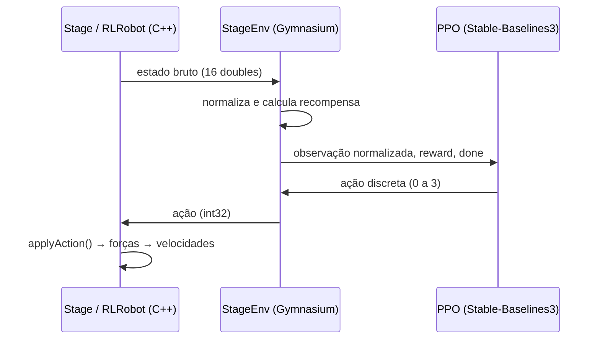

# RLRobot — Coordenação ad hoc em enxames de robôs com Aprendizado por Reforço (PPO)

Este repositório contém o **RLRobot**, um agente ad hoc treinado com **Proximal Policy Optimization (PPO)** para o **Problema do Alvo Comum** (*Common Target Problem*) no simulador [Stage](https://github.com/rtv/Stage). Ele é o código do TCC:

> **Coordenação Ad hoc em Enxames de Robôs para o Problema do Alvo Comum: Uma Abordagem baseada em Aprendizado por Reforço para Redução de Conflitos**
> João Pedro Santiago de Jesus — UFRB, 2026. Orientadora: Profª. Drª. Camila Bezerra da Silva.

O RLRobot substitui a heurística **Ad Hoc Follower (AHF)** da tese de [Passos (2023)](https://research.lancaster-university.uk/en/publications/congestion-control-of-robotic-swarms-in-the-common-target-problem/). Em vez de regras fixas, uma rede neural escolhe, a partir da leitura local dos sensores, qual comportamento de navegação executar.

---

## Sumário

1. [Visão geral](#1-visão-geral)
2. [Arquitetura](#2-arquitetura)
3. [O RLRobot (C++)](#3-o-rlrobot-c)
4. [Código Python (PPO)](#4-código-python-ppo)
5. [Protocolo de comunicação](#5-protocolo-de-comunicação)
6. [Como executar](#6-como-executar)
7. [Resultados do TCC](#7-resultados-do-tcc)
8. [Estrutura dos arquivos](#8-estrutura-dos-arquivos)
9. [Projeto base (AHF)](#9-projeto-base-ahf)

---

## 1. Visão geral

No Problema do Alvo Comum, todos os robôs do enxame precisam alcançar a mesma região, o que gera congestionamentos. Nos cenários de **equipe mista**, parte dos robôs é *consciente* (executa SQF, TRVF ou NoCoord) e parte é *ad hoc*: não conhece o algoritmo dos demais.

O RLRobot é o robô ad hoc. A cada decisão ele:

1. monta um **vetor de estados** de 16 posições com os sensores e a dinâmica do robô;
2. envia esse vetor por **socket TCP** a um processo Python;
3. recebe de volta uma das **4 ações discretas**;
4. converte a ação em forças (atração, repulsão, fuga) que viram velocidades no Stage.

| Ação | Comportamento | Implementação em `applyAction` |
|:---:|---|---|
| `0` | Parar | `fx = fy = 0` |
| `1` | Seguir para o alvo | força atrativa ao destino + repulsão de obstáculos |
| `2` | Seguir o vizinho | `followNeighbor()` + repulsão de obstáculos |
| `3` | Sair do alvo | força atrativa invertida + repulsão de obstáculos |

Qualquer valor fora de 0–3 cai no comportamento da ação 1.

---

## 2. Arquitetura

O Stage (C++) e o aprendizado (Python) são processos separados que conversam por TCP. O C++ é o **cliente** e o Python é o **servidor**.



Há dois modos de uso do servidor Python:

| Modo | Script | Conexões | O que faz |
|---|---|---|---|
| **Treino** | `train_curriculum.py` (+ `stage_env.py`) | 1 robô por vez | calcula recompensa e atualiza a política com `model.learn()` |
| **Inferência** | `inference_server.py` | vários robôs (1 thread por robô) | só normaliza, chama `model.predict()` e devolve a ação, com a política congelada |

---

## 3. O RLRobot (C++)

Arquivos: `RLRobot.h` e `RLRobot.cpp`. A classe herda de `Robot` e é instanciada em `init.cpp` para os robôs que não são do grupo consciente (`new RLRobot(cf)`).

### 3.1 Ciclo de controle (`mainLoop`)

A cada iteração da simulação:

```text
numIterations++ → checkStall() → getPosition()
salva o alvo inicial (uma única vez)
saveLogAndWaitIfFinished() / updateLogWhenLeavingTarget()

se skipCounter % persistence == 0:      ← hora de decidir
    collectState(state)                 ← monta o vetor de 16 posições
    currentAction = communicateWithPython(state)
    skipCounter = 0
skipCounter++

applyAction(currentAction)              ← ação vira forças fx, fy
setNewDestinationIfOnTarget(...), checkTimeIsOver(), setDestination()
setConstantModule(fx, fy, maxForce) → setSpeeds()
```

**Persistência da ação.** O agente não é consultado a cada iteração. Com `persistence = 15`, a mesma ação é mantida por 15 iterações antes de nova consulta. Isso reduz o tráfego no socket e evita trocas de comportamento a cada passo.

**Alvo inicial.** Na primeira iteração, `destinationX/Y` é guardado em `initialTargetX/Y`. O vetor de estados usa sempre esse alvo como referência. Assim, a posição relativa não muda quando o robô troca de waypoint ou termina a tarefa.

### 3.2 Vetor de estados (`collectState`)

A função `collectState(double state[STATE_SIZE])` concentra a montagem do estado. Ela corresponde à Tabela 3.2 do TCC.

| Índice | Variável | Descrição |
|:---:|---|---|
| 0 | `dx` | `initialTargetX - m_x` |
| 1 | `dy` | `initialTargetY - m_y` |
| 2 | `linSpeed` | velocidade linear atual |
| 3 | `rotSpeed` | velocidade angular atual |
| 4–15 | `scan[12]` | menor distância do laser em cada um dos 12 setores |

O scan do laser é dividido em `NUM_SECTORS = 12` setores contíguos, e cada setor guarda a **menor leitura** entre suas amostras, limitada a `d` (distância de influência, 3 m por padrão). Os setores seguem a ordem das amostras do laser no Stage. `STATE_SIZE = 4 + NUM_SECTORS = 16`.

```cpp
void RLRobot::collectState(double state[STATE_SIZE]) {
    state[0] = initialTargetX - m_x;
    state[1] = initialTargetY - m_y;
    state[2] = linSpeed;
    state[3] = rotSpeed;

    const std::vector<meters_t>& scan = laser->GetSensors()[0].ranges;
    int samplesPerSector = scan.size() / NUM_SECTORS;

    for (int s = 0; s < NUM_SECTORS; s++) {
        double minDist = d;
        for (int i = 0; i < samplesPerSector; i++) {
            int idx = s * samplesPerSector + i;
            if (idx < (int)scan.size() && scan[idx] < minDist)
                minDist = scan[idx];
        }
        state[4 + s] = minDist;
    }
}
```

O C++ envia valores **brutos**. A normalização é feita no lado Python (ver [seção 4.1](#41-normalização)).

### 3.3 Comunicação (`communicateWithPython` e `reconnect`)

- No `init()`, o robô lê a porta `rlPort` do arquivo de configuração (padrão **5000**) e conecta em `127.0.0.1`.
- `communicateWithPython` envia `16 * sizeof(double)` bytes e espera um `int` de resposta.
- Se a conexão falhar (envio ou recepção), `socketConnected` vira `false` e o método devolve a **ação 1** (ir para o alvo) como *fallback*. Na chamada seguinte ele tenta `reconnect()`.

### 3.4 Ações (`applyAction` e `followNeighbor`)

`applyAction` usa as primitivas já existentes em `Robot`: `setAttractiveForce` (módulo `Ka`, apontando ao destino) e `obstaclesRepulsionForces` (repulsão dos lasers).

`followNeighbor` (ação 2) varre as leituras do laser e considera como vizinho candidato qualquer leitura com `0.3 < distância < d`. Entre elas, escolhe a direção com maior produto escalar com a direção do alvo, desde que acima de `minDotProductToFollow`. Se encontra um vizinho, a força aponta para ele (módulo `Ka`). Caso contrário, o robô segue para o alvo.

### 3.5 Parâmetros relevantes

| Parâmetro | Valor | Onde |
|---|---|---|
| `persistence` | 15 iterações | `RLRobot::init` |
| `NUM_SECTORS` / `STATE_SIZE` | 12 / 16 | `RLRobot.h` |
| `rlPort` | 5000 (padrão) | arquivo `.ini` |
| Ação de *fallback* | 1 (ir para o alvo) | `communicateWithPython` |

---

## 4. Código Python (PPO)

### 4.1 `stage_env.py` — ambiente Gymnasium (`StageEnv`)

Encapsula o Stage como um ambiente `gymnasium.Env`.

- `action_space = Discrete(4)`
- `observation_space = Box(shape=(16,))`
- Abre um servidor TCP (`bind` + `listen(1)`) e aguarda o RLRobot em `reset()`.

#### Normalização

Constantes no topo do arquivo:

```python
MAX_DIST  = 15.0   # dx, dy
MAX_VEL   = 1.0    # linSpeed, rotSpeed
MAX_LASER = 3.0    # 12 setores do scan
```

`normalize_state` divide cada grupo pela constante correspondente e aplica `clip(-5, 5)`. Antes disso, o estado passa por saneamento: valores `NaN` viram 0, `inf` vira `MAX_LASER`, e se `|dx|` ou `|dy|` passarem de `10 * MAX_DIST` (destino inválido do Stage), ambos são zerados.

#### Fases do ambiente e recompensa

O episódio tem duas fases (Seção 3.3.1 do TCC). Sendo `d_t` a distância ao centro do alvo:

| | **Fase 0 — Buscando o alvo** | **Fase 1 — Fugindo do congestionamento** |
|---|---|---|
| Progresso | `clip(10·(d_{t-1} − d_t), −10, 10)` | `clip(10·(d_t − d_{t-1}), −10, 10)` |
| Colisão (`min(scan) < 0.8`) | −3 | −10 |
| Troca de ação | −0.8 | — |
| Velocidade linear < 0.1 | −1.5 | — |
| Penalidade de tempo | −0.2 | −0.5 |
| Transição / término | `d_t < 3.15` → **+50** e vai para a fase 1 | `d_t > 8.0` → **+50** e `done = True` |

Os valores acima são os do código e correspondem à Equação 3.1 do TCC:
`R_t = r_alvo + r_chegada − p_colis − p_inat − p_tempo − p_troca`.

A mudança de fase **não** encerra o episódio. O robô continua na simulação e passa a ser recompensado por sair da zona congestionada. O indicador de fase não faz parte da observação de 16 valores.

### 4.2 `train_curriculum.py` — treinamento

Treina o PPO com `MlpPolicy` e aprendizado por **currículo de cenários**.

```bash
python train_curriculum.py                              # padrões do TCC
python train_curriculum.py --resume models/PPO_Robot/ppo_robot_curriculum_80000_steps.zip
```

| Opção | Padrão | Descrição |
|---|---|---|
| `--total-timesteps` | 160000 | total de passos de treino |
| `--learning-rate` | 1e-4 | taxa de aprendizado |
| `--checkpoint-every` | 20000 | frequência dos checkpoints |
| `--models-dir` | `models/PPO_Robot` | onde salvar os modelos |
| `--logdir` | `logs` | logs do TensorBoard |
| `--resume` | — | retoma de um checkpoint `.zip` |
| `--host` / `--port` | `127.0.0.1` / `5000` | endereço do servidor |

Recursos úteis: checkpoints periódicos, retomada de treino e salvamento do modelo ao receber `Ctrl+C` ou `SIGTERM` (`ppo_robot_curriculum_interrupted.zip`).

**Hiperparâmetros (Tabela 3.5 do TCC).** Só a taxa de aprendizado foge do padrão da Stable-Baselines3. O restante usa os valores *default* da biblioteca.

| Parâmetro | Valor |
|---|---|
| Política | `MlpPolicy` |
| Taxa de aprendizado | 1e-4 |
| Total de passos | 160000 |
| `n_steps` / `batch_size` / `n_epochs` | 2048 / 64 / 10 |
| γ / GAE λ / clip range | 0.99 / 0.95 / 0.2 |
| Coef. de entropia / coef. da função valor | 0.0 / 0.5 |

**Currículo (Tabela 3.6 do TCC).** O script `run_curriculum.sh` percorre combinações de cinemática (holonômica e não holonômica), algoritmo dos robôs conscientes (NoCoord, SQF e TRVF) e tamanho do enxame (20, 100 e 250 robôs). Em cada cenário há **1 robô RL** (`m = 1`) e `N − 1` robôs conscientes. Cada combinação é repetida 15 vezes para cada um dos 3 valores de `neighbourhoodAngle`, totalizando 45 episódios por combinação. O RLRobot não usa esse ângulo (ele só mantém a compatibilidade com o mapa de logs do AHF). Treino concluído em ≈ 160 mil passos.

### 4.3 `inference_server.py` — servidor de inferência

Usado nos experimentos de avaliação. Carrega o `.zip` do PPO treinado e atende **vários RLRobots ao mesmo tempo**, com uma thread por conexão. A rede é compartilhada entre as threads, somente para leitura (Seção 3.6 do TCC).

```bash
python inference_server.py --model models/PPO_Robot/ppo_robot_curriculum_final.zip
```

Não há cálculo de recompensa, nem fase, nem aprendizado. O fluxo é: receber estado, normalizar com as mesmas constantes do `StageEnv`, `model.predict(obs, deterministic=True)` e devolver a ação.

> As constantes `MAX_DIST`, `MAX_LASER`, `MAX_VEL` e a função de normalização existem **duas vezes** (`stage_env.py` e `inference_server.py`). Se alterar uma, altere a outra.

### 4.4 Outros scripts

| Arquivo | Função |
|---|---|
| `train.py` | versão simples do treino (300 mil passos, sem checkpoints) |
| `test_rl.py` | roda um modelo já treinado sobre o `StageEnv` (1 robô) |
| `compare_ahf_vs_rlfollower.py`, `plot_4_grouped_comparisons.py` | comparação e gráficos AHF × RLRobot |
| `organize_world.py` | organização de cenários |
| `run_curriculum.sh` | executa o currículo de treino |
| `run_rlfollower_experiments.sh` | executa os experimentos de avaliação (40 repetições por cenário) |

---

## 5. Protocolo de comunicação

Mensagens binárias, sem cabeçalho, em ordem de bytes nativa da máquina (little-endian em x86).

| Sentido | Conteúdo | Tamanho |
|---|---|---|
| C++ → Python | 16 × `double` (`state[0..15]`) | 128 bytes |
| Python → C++ | 1 × `int` (ação, 0 a 3) | 4 bytes |

No treino, `StageEnv.step(action)` envia a ação e depois lê o próximo estado. Em `reset()`, ele aceita a nova conexão e lê o estado inicial. O processo do Stage é reiniciado a cada episódio pelo `test.sh`/`experiment.sh`.

Python:

```python
state = struct.unpack('16d', conn.recv(16 * 8))
conn.sendall(struct.pack('i', int(action)))
```

C++:

```cpp
send(client_fd, state, sizeof(double) * 16, 0);
recv(client_fd, &action, sizeof(int), 0);
```

---

## 6. Como executar

### Dependências

- [Stage 4.3.0](https://github.com/rtv/Stage), Ubuntu 24.04 e compilador C++
- Python 3 com: `stable-baselines3`, `gymnasium`, `numpy`, `torch` (testado com Python 3.12, SB3 2.7.1, Gymnasium 1.2.3, PyTorch 2.10, NumPy 1.26.4)

```bash
pip install stable-baselines3 gymnasium numpy torch
```

### Compilação

```bash
make
```

### Treinar o agente

```bash
# Terminal 1 – servidor de treino (fica aguardando o Stage)
python train_curriculum.py

# Terminal 2 – dispara os cenários do currículo
bash run_curriculum.sh
```

Acompanhe o treino com `tensorboard --logdir logs`.

### Avaliar o agente treinado

```bash
# Terminal 1 – servidor de inferência
python inference_server.py --model models/PPO_Robot/ppo_robot_curriculum_final.zip

# Terminal 2 – experimentos (RLRobot no lugar do AHF)
bash run_rlfollower_experiments.sh SET_A      # ou SET_B, ou SET_A SET_B
```

Nos experimentos, `m` é a quantidade de robôs RLRobot e `n` a de robôs conscientes, com `total = n + m`. As proporções de RLRobots avaliadas são 10%, 50% e 90%.

---

## 7. Resultados do TCC

Avaliação com 100 e 200 robôs, cinemática holonômica e não holonômica, robôs conscientes SQF e TRVF, e 10%, 50% e 90% de agentes ad hoc. Foram 40 execuções por configuração, com *timeout* de 3600 s de tempo simulado. As métricas foram vazão (*throughput*), tempo total, soma dos tempos e tempo de chegada do último robô.

O RLRobot (PPO) teve desempenho superior ao AHF na quase totalidade das configurações. A exceção foi o caso de robôs holonômicos com SQF, 100 robôs e 10% de agentes ad hoc, onde houve empate. Os dados completos estão no Capítulo 4 do TCC, em especial na Tabela 4.2.

---

## 8. Estrutura dos arquivos

```text
RLRobot.h / RLRobot.cpp        agente ad hoc (cliente TCP) – foco deste README
Robot.h / Robot.cpp            classe base (forças, sensores, log, velocidades)
SQF / TRVF / NoCoord           algoritmos dos robôs conscientes
init.cpp                       instancia os robôs (RLRobot para os robôs ad hoc)

stage_env.py                   ambiente Gymnasium + recompensa (treino)
train_curriculum.py            treino PPO com checkpoints e retomada
inference_server.py            servidor multi-robô de inferência
train.py / test_rl.py          treino simples / teste de um modelo
ppo_robot_final.zip            modelo PPO treinado (Stable-Baselines3)

run_curriculum.sh              currículo de treinamento
run_rlfollower_experiments.sh  experimentos de avaliação
experiment.sh / test.sh        execução de cenários no Stage
```

---

## 9. Projeto base (AHF)

Este trabalho parte do código do **Ad Hoc Follower** ([swarm-ad-hoc-follower](https://www.research.lancs.ac.uk/portal/services/downloadRegister/401931354/2023passosphd.pdf), Passos, 2023). Os algoritmos SQF, TRVF e NoCoord, a infraestrutura de experimentos (`experiment.sh`, `test.sh`) e o formato dos logs vêm desse projeto.

- O AHF é ativado com `neighbourhoodAngle` diferente de zero em `config.ini`. As equipes mistas (AHMT) usam `neighbourhoodAngle = 0`.
- O RLRobot **não usa** `neighbourhoodAngle` nem `alternativeAlgorithm`.
- Exemplo de experimento em lote (40 testes variando `m`):

```bash
nTests=40
varsExp=( m )
minExp=( 20 )
maxExp=( 120 )
increment=( 20 )
folderConf="nonholo/NoCoordAlt/SQF/robots_200/"
defaultVarNames=(s v K n m d D holo algorithm neighbourhoodAngle alternativeAlgorithm)
defaultValues=(  3 1 5 180 50 3 13 0 SQF 0 NoCoord)
```

```bash
bash experiment.sh config_m
```

---

## Referências

- Passos, 2023. *Swarm ad hoc follower* (tese, Lancaster University).
- Schulman et al., 2017. *Proximal Policy Optimization Algorithms*.
- Raffin et al., 2021. *Stable-Baselines3*.
- Towers et al., 2024. *Gymnasium*.
- Vaughan, 2008. *Stage: A multiple robot simulator*.
